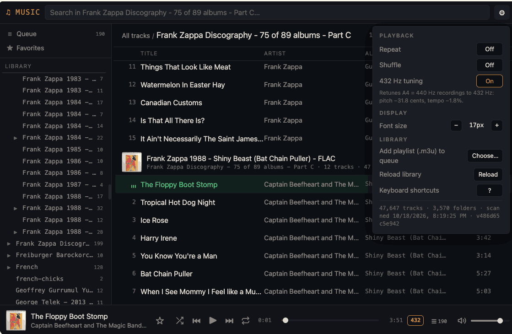

# 432 Hz Music Player

> [!IMPORTANT]
> This project is _NOT_ a **432 Hz Music Player**! 
> 
> It is a python script that you run _once_ in your music folder, it creates a static index.html file that you then double-click and open in your browser to give you a full **432 Hz Music Player** experience without having to install anything. 
> 
> Technically, it is **432 Hz Music Player** creator script. 
> 
> You open `index.html` directly in the browser (over the `file://` protocol) — no server required. It can handle music collections of 100k+ tracks. If you already run a web server then the index.html will allow you to access the music player from any host that has access to you server.



## Features

### Player
- **Dark UI** with resizable folder sidebar, breadcrumbs, album headers with cover art, now-playing bar
- **Search** in the current folder or everywhere: every word must match (title, artist, album, album artist, genre, year, folder, file name), accent-insensitive (`arbol` finds `Árbol`)
- **Queue** with two tiers, like Spotify / Apple Music: clicking a track plays it and the rest of the view continues after it; tracks you queue by hand (*Play next*, *Add to queue*, drag & drop) play first and survive any click. The Queue view shows *Now playing*, *Next up* (drag to reorder, ✕ to remove, Clear with Undo) and *Next from …*
- **Favorites** (☆ on any track, <kbd>L</kbd> for the playing one, or drag tracks onto Favorites)
- **Shuffle** that keeps already-played tracks and reverts to album order when turned off; **repeat** off / all / one
- **432 Hz tuning**: retunes A4 = 440 Hz recordings to 432 Hz (pitch −31.8 cents, tempo −1.8 %)
- **Deep links**: the URL reflects the folder and search (`index.html#/Jazz/Blue%20Train?q=live`), so reload, bookmarks and Back/Forward work; *Copy link* on a track opens it highlighted and ready to play
- **Restores everything after a reload**: queue, playing track and position, shuffle/repeat, volume, font size, sidebar width
- **M3U playlists**: save the queue or favorites as `.m3u8` (opens in VLC, foobar2000 …); drop an `.m3u` on the page to queue it
- **Media keys** and OS now-playing widgets (Media Session API)
- **Phone layout**: slide-over library, two-line rows, full-width seek bar
- Missing or unplayable files are skipped with a notice

### Context menus
Right-click (or the ⋯ button) on tracks, album headers, folders, Queue and Favorites: play, shuffle, play next, add to queue, favorite, go to folder, copy link / file URL, download, track info, save as `.m3u`.

Clicking an album header plays that folder and keeps your place in the list; open the folder from its menu (*Open folder*) or the sidebar.

### Keyboard shortcuts
| Key | Action | Key | Action |
|---|---|---|---|
| <kbd>Space</kbd> | Play / pause | <kbd>S</kbd> | Shuffle |
| <kbd>N</kbd> / <kbd>P</kbd> | Next / previous | <kbd>R</kbd> | Repeat off / all / one |
| <kbd>←</kbd> / <kbd>→</kbd> | Seek 5 s (<kbd>Shift</kbd>: 30 s) | <kbd>T</kbd> | 432 Hz tuning |
| <kbd>↑</kbd> / <kbd>↓</kbd> | Volume | <kbd>L</kbd> | Favorite the playing track |
| <kbd>M</kbd> | Mute | <kbd>Q</kbd> | Queue |
| <kbd>0</kbd> … <kbd>9</kbd> | Jump to 0 … 90 % | <kbd>G</kbd> | Show the playing track |
| <kbd>/</kbd> or <kbd>F</kbd> | Search | <kbd>?</kbd> | All shortcuts |

Browser shortcuts (<kbd>⌘F</kbd>, <kbd>Ctrl+P</kbd> …) are never intercepted.

## Usage

```bash
uv run mugal.py [ROOT] [options]     # installs mutagen + enzyme automatically
python mugal.py [ROOT] [options]     # uses whatever is installed
```

`ROOT` defaults to the current folder.

`player.html` is the player template. mugal reads it from next to `mugal.py` (the default), or from the user data folder: `$XDG_DATA_HOME/mugal` if set, else `~/Library/Application Support/mugal` (macOS), `~/.local/share/mugal` (Linux), `%LOCALAPPDATA%\mugal` (Windows). If neither has a usable copy, mugal downloads it from GitHub and saves it next to itself, or in the data folder when that's read-only, or keeps it in memory for that run. A local copy is never checked online. Offline with no copy at all, `audiodata.js` is still written and an existing `index.html` is kept.

`--self-update` compares `mugal.py` and `player.html` with the latest on GitHub and, after asking, replaces them in place (a newer data schema always brings its matching player along). Locally edited files at the same version are left alone unless you add `--force`. If their folder isn't writable (e.g. `/usr/local/bin`), nothing changes: run it with `sudo`, or keep both files in a folder you own.

### Options

```
-o, --output DIR       where index.html + audiodata.js go (default: ROOT)
--covers DIR           save covers extracted from tags to DIR (default: cover.<ext> in each
                       album folder, or OUTPUT/.mugal/covers when the folder is read-only)
--no-art               skip cover art entirely
--exclude GLOB         skip files/folders by path relative to ROOT or by name (repeatable)
--all                  also scan hidden/system folders (.*, $RECYCLE.BIN, @eaDir, .nomedia, Android/data …)
--min-duration SEC     skip tracks shorter than SEC seconds
--force-rescan         ignore the scan cache and re-read every file
-j, --jobs N           parallel tag readers (default 0 = auto: threads only when reads are slow, e.g. NAS)
--no-html              only rewrite audiodata.js
-x, --extract-template only (re)write index.html, skip scanning
--self-update          update mugal.py and player.html in place to the latest on GitHub (asks first), then exit
--force                overwrite an index.html that mugal didn't create
                       (with --self-update: also replace locally edited mugal.py / player.html)
--no-open              don't open the browser when done
--serve [[HOST:]PORT]  serve over HTTP for debugging (default 127.0.0.1:8000; no seeking)
-v, --verbose          list every file read and every file skipped
```

### Examples

```bash
# process current folder
python3 mugal.py
python3 mugal.py ~/Music
python3 mugal.py ~/Music --exclude Podcasts --exclude '*.wav'
python3 mugal.py /Volumes/NAS/Music -o ~/player --min-duration 30
python3 mugal.py ~/Music --no-open              # e.g. from cron / launchd
```
### run without installing with [uv](https://docs.astral.sh/uv/getting-started/installation/)
```
uv run https://raw.githubusercontent.com/glowinthedark/432-hz-music-player/refs/heads/master/mugal.py
```

## Output

- `index.html`: the player (no external dependencies)
- `audiodata.js`: compact track data (≈ 100 bytes per track; 100k tracks ≈ 10 MB)
- `.mugal/`: scan cache, `scan-report.txt` (unreadable files, skipped folders), covers extracted from read-only folders. If OUTPUT isn't writable, the cache and report go to the user cache folder instead (`$XDG_CACHE_HOME/mugal`, else `~/Library/Caches/mugal` on macOS, `~/.cache/mugal` on Linux, `%LOCALAPPDATA%\mugal\Cache` on Windows), so rescans stay fast

Files are replaced atomically (temp file + rename). If only the files themselves are writable, not their folder (e.g. write permission granted on `audiodata.js` alone), they're overwritten in place instead; `index.html` isn't rewritten when it's already current. If `audiodata.js` can't be written at all, mugal stops before scanning and suggests `-o DIR`.

Rescans only re-read new or changed files, so they're near-instant. Hidden and system folders are skipped on macOS, Windows, Linux, Android and NAS volumes, and so are folders containing `.nomedia` (use `--all` to include them). Folder symlinks are followed, with loop detection.

`--serve` is a small debugging helper. For regular use, open `index.html` from disk or put the folder behind a real web server (Caddy, nginx, Apache), which also enables seeking over HTTP. If nginx denies dot-files, allow `/.mugal/covers/`.

## Requirements

- **Python 3.10+**
- **[`mutagen`](https://github.com/quodlibet/mutagen)** for tags, durations and embedded covers. Without it, tracks are listed by file name.
- **[`enzyme`](https://github.com/Diaoul/enzyme)** for `.webm` tags and durations (mutagen can't read Matroska). If `.webm` files are found without it, mugal offers to continue, retry after you install it, or abort.

`uv run mugal.py` installs both automatically (they're declared in the script header).

### Supported audio formats

`.mp3`, `.flac`, `.ogg`, `.opus`, `.m4a`, `.aac`, `.wav`, `.webm` (whether a format plays depends on the browser's codecs).

## How it works

1. Walks the root folder, pruning skipped and excluded folders before descending
2. Reads tags with mutagen (enzyme for `.webm`), reusing cached results for unchanged files
3. Picks one cover per folder: an image file (`cover` > `folder` > `front` > `albumart` > `album` > `artwork` > `art` > any, largest wins), else art embedded in a track, else the parent folder's cover
4. Sorts tracks by folder, disc, track number and natural file name, and writes `audiodata.js` and `index.html`
